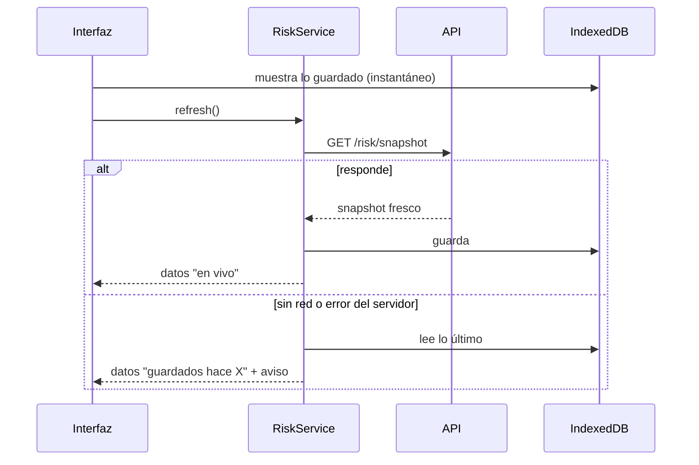
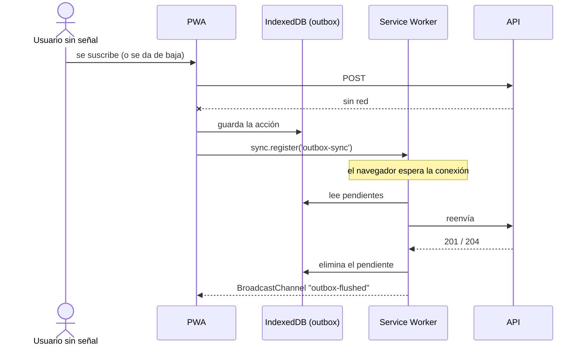

# Estrategia offline-first

El reto técnico central de AlertaSinRed no es el modelo de IA: es que la alerta siga
disponible cuando no hay internet, que es justo cuando más falta hace.

## 1. Qué se guarda y dónde

| Recurso | Almacén | Estrategia | Cuándo se actualiza |
|---|---|---|---|
| App shell (HTML, JS, CSS, íconos) | Cache Storage | *Precache* (Workbox) | Al instalar una versión nueva del Service Worker |
| Rutas de la SPA (`/zona/:id`…) | Cache Storage | `index.html` precacheado | Igual que el app shell |
| Estado de riesgo (`/risk/snapshot`) | IndexedDB (`snapshot`) | *Network-first* con respaldo local (sin caché del Service Worker, para no mostrar una copia vieja como fresca) | Al abrir la app, al volver la red, con reintentos y cada hora con Periodic Sync |
| Detalle de una zona visitada (`/zones/{id}`) | Cache Storage | *Network-first* (4 s) | Al abrir un enlace directo |
| Historial de una zona | Cache Storage | *Stale-while-revalidate* | Cada vez que se consulta |
| Ficha del modelo de IA (`/model`) | Cache Storage | *Stale-while-revalidate* | Al abrir "Cómo funciona" |
| Preferencias ("mi zona", avisos, idioma) | IndexedDB (`preferences`) | Local | Al cambiarlas |
| Suscripciones y bajas hechas sin red | IndexedDB (`outbox`) | Patrón *Outbox* + Background Sync | En cuanto vuelve la conexión |
| Suscripciones de este dispositivo | IndexedDB (`subscriptions`) | Local | Al suscribirse o darse de baja |
| `/auth/*`, `/admin/*` | — | **Nunca** se guardan | — |

## 2. Lectura: *network-first* con respaldo

- Un **solo endpoint** trae todas las zonas con su última evaluación: con una descarga
  exitosa el dispositivo tiene todo lo necesario para operar sin conexión, incluso el
  cálculo de "zonas cerca de mí" (Haversine en el dispositivo).
- Si el servidor tarda (el plan gratuito de Render se duerme), la app reintenta sola con
  esperas crecientes (4 s, 8 s, 15 s, 30 s, 60 s).

## 3. Escritura: bandeja de salida (*Outbox*)

- **Idempotencia:** reenviar una suscripción no crea duplicados (el backend responde con
  la existente); una baja repetida responde 404 y se considera resuelta.
- **Errores permanentes y transitorios:** un 4xx (dato inválido) se descarta e informa;
  un 5xx o la falta de red se reintentan (hasta 8 veces).
- **Navegadores sin Background Sync** (Firefox, Safari): la página vacía la bandeja al
  recibir el evento `online`.
- El **código de baja** que entrega el servidor se guarda en IndexedDB: solo el
  dispositivo que se suscribió puede darse de baja.

## 4. Migraciones de IndexedDB

`database.ts` versiona el esquema. Cada versión solo agrega lo suyo dentro de `upgrade`,
así un dispositivo que venía de la versión 1 conserva su snapshot y su bandeja de salida
al actualizar la app.

| Versión | Cambio |
|---|---|
| 1 | Almacenes `snapshot` y `outbox` |
| 2 | Almacén `subscriptions` (códigos de baja) |
| 3 | Almacén `preferences` ("mi zona", avisos activados, último nivel avisado; el idioma se guarda aquí sin cambiar de versión) |

## 5. Avisos en el dispositivo

Si la persona fijó "mi zona" y activó los avisos, `RiskNotifier` (compartido por la
página y el Service Worker) muestra una notificación cuando esa zona sube a riesgo alto
o muy alto, solo si el nivel subió respecto del último aviso. Con la PWA instalada en
Chrome, el *Periodic Background Sync* refresca el riesgo cada hora y avisa aunque la
app esté cerrada. Las preferencias viven en IndexedDB y no en `localStorage` porque el
Service Worker no puede leer `localStorage`.

## 6. Actualizaciones de la app

El Service Worker usa `registerType: 'prompt'`: cuando hay una versión nueva, la app lo
avisa ("Hay una nueva versión disponible") en lugar de recargar por sorpresa en medio de
una consulta.
